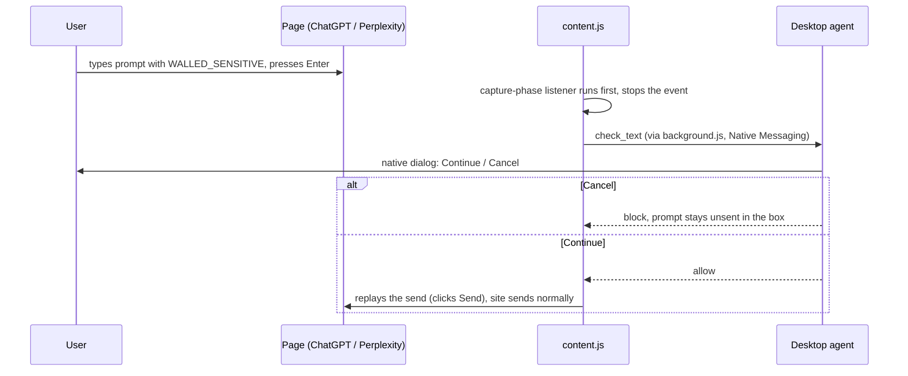

# Walled DLP Guard

**A lightweight desktop DLP (data loss prevention) app for ChatGPT and Perplexity.** It checks every prompt and
every uploaded file (text, PDF and image) for the marker **`WALLED_SENSITIVE`**. When the marker is found, it
shows a **native Windows Continue / Cancel dialog** *before* anything leaves the browser. It also changes the
text colour of AI-generated responses on both sites.


> **Demo video:** _add link here_ · Built for the Walled AI take-home assignment (final screening round).

---

## Contents

1. [What it does](#what-it-does)
2. [Architecture](#architecture)
3. [How interception works](#how-interception-works)
4. [Detection](#detection-text-pdf-images)
5. [Installation](#installation)
6. [Try it](#try-it)
7. [Security and reliability](#security-and-reliability)
8. [Testing](#testing)
9. [Project layout](#project-layout)
10. [Limitations and future work](#limitations-and-future-work)

---

## What it does

| Requirement | Implementation |
|---|---|
| Monitor text prompts on ChatGPT and Perplexity | The Enter key, Send button and form submit are intercepted *before* the site handles them |
| Monitor file uploads (text, PDF, image) | The file picker, drag and drop, and paste are held until the desktop agent has scanned each file |
| Detect `WALLED_SENSITIVE` | Text: direct match. PDF: text layer, plus **OCR of scanned pages**. Images: **Tesseract OCR** (also dark-mode screenshots) |
| Native desktop Continue / Cancel dialog | A real Windows `MessageBox` (user32), always on top, **Cancel is the default**, and it auto-cancels after 2 minutes |
| Action proceeds only on Continue | Cancel means the prompt or file never reaches the site. Continue replays the original action |
| Change the colour of AI-generated responses | Injected CSS recolours only the AI's answers (default orange, configurable in the popup). The user's own messages are unchanged |

**Verified end to end in logged-in Chrome** (Windows 11), on both **chatgpt.com** and **perplexity.ai**: prompts,
text and scanned PDFs, PNG screenshots, clean files passing without a dialog, and recoloured answers.

---

## Architecture

Python alone can't reliably see what is typed or attached inside a web page, and the page can't show a native
desktop dialog. So the work is split between a **browser extension** (the sensor) and a **Python desktop
agent** (the decision maker). They connect through **Chrome Native Messaging**: Chrome launches the agent and
talks to it over stdin/stdout, so no network port is opened.

```
 chatgpt.com / perplexity.ai tab
 ┌──────────────────────────────────────────────────────────────┐
 │ content.js (isolated world)            page_hook.js (page world)│
 │  layer 1: Enter / Send / file picker /   layer 2: fetch + XHR    │
 │  drag-drop / paste held in the capture   wrapped at document_start│
 │  phase; recolours AI answers (CSS)       (backstop)               │
 └──────────────┬───────────────────────────────────┬──────────────┘
                │ chrome.runtime messages            │ window.postMessage
                ▼                                    │ (asks content.js)
      background.js (service worker) ◄───────────────┘
                │ chrome.runtime.connectNative("com.walled.dlp_guard")
                ▼ length-prefixed JSON over stdin/stdout
 ┌──────────────────────────────────────────────────────────────┐
 │ Python desktop agent (agent/host.py)                           │
 │  scanner.py: text · PDF (pypdf) · OCR (Tesseract) · Office XML │
 │  dialog.py:  native Windows Continue / Cancel                  │
 │  tray.py:    tray icon (checks / flagged counts)               │
 └──────────────────────────────────────────────────────────────┘
```

---

## How interception works



- **Layer 1 (`content.js`): intercepting user actions.** Listeners on `window` in the **capture phase** run
  before the site's own handlers.
  - **Prompts:** Enter, the Send/Submit button and form `submit` are stopped *only* if the prompt contains the
    marker. Clean prompts are never delayed.
  - **Files:** every file from the picker (`change`/`input`), drag and drop, or paste is held and sent to the
    agent for scanning. Allowed files are re-delivered by re-dispatching the original event with a rebuilt
    `DataTransfer`; blocked files are dropped. Several files are checked one at a time, each with its own
    decision.
  - **Agent unreachable:** fail closed, meaning the action is blocked and an in-page message explains why.
- **Layer 2 (`page_hook.js`): network backstop.** It runs in the page's own JavaScript world at
  `document_start`, before the site can keep a private copy, and wraps `fetch` and `XMLHttpRequest`.
  - **Text:** any outgoing body containing the marker is held until a decision is made.
  - **Files:** any uploaded `File` (in `FormData` or a direct `PUT`) is held the same way. This catches paths
    layer 1 might miss when a site changes its UI.
  - **No double prompts:** a short "grant" after a layer-1 decision keeps the site's follow-up requests from
    being asked about twice.
- **Response colouring:** CSS with `!important` targets only the AI-answer containers. ChatGPT also colours
  text through per-span CSS variables (`--d-stream-ink`), which are overridden too. The user's own messages are
  explicitly excluded.

Selectors were checked against the **live** sites (logged in and logged out). Several variants are kept per site
because the layouts differ.

---

## Detection: text, PDF, images

`agent/scanner.py` decides the file type from its **content** (magic bytes), not its name.

| Content | How it is scanned |
|---|---|
| Text files (`.txt`, `.md`, `.csv`, `.json`, code…) | Decoded (UTF-8 / UTF-16) and matched |
| PDF | `pypdf` text layer per page. If there's no match, the embedded images are **OCR'd** (for scanned PDFs) |
| Images (PNG, JPEG, GIF, BMP, TIFF, WebP) | **Tesseract OCR** in up to three passes: grayscale and upscaled, then thresholded, then **inverted** for light-on-dark screenshots |
| Office (`.docx`/`.xlsx`/`.pptx`), as a bonus | The XML parts inside the zip are scanned |

Matching is deliberately tolerant, because a DLP tool should prefer catching too much over too little. It is
case-insensitive, ignores spaces, underscores and line breaks, and maps common OCR confusions (`0→O`, `1→I`,
`5→S`). So `walled sensitive`, `WALLED_\nSENSITIVE` and an OCR'd `WALLED_5ENSITIVE` all match. The rules are
identical in Python and JavaScript, and tests check that they agree.

If a PDF or image can't be inspected (password-protected, OCR not installed, or larger than 40 MB), the user is
asked with an explanation; it is never silently allowed.

---

## Installation

Requirements: Windows 10/11, **Python 3.10+** (tested with 3.14), Google Chrome (or Edge), and **Tesseract OCR**
for images.

```bash
git clone https://github.com/yesubabu7/walled-ai-dlp-guard.git
cd walled-ai-dlp-guard
python -m venv .venv
.venv\Scripts\activate
pip install -r requirements.txt
winget install --id UB-Mannheim.TesseractOCR      # OCR engine (one time)
python scripts\install.py                         # register the agent with Chrome and Edge (per user)
```

`install.py` writes `native/walled_dlp_host.bat` and the host manifest, and registers the host under
`HKCU\Software\Google\Chrome\NativeMessagingHosts\com.walled.dlp_guard`. Only this extension's fixed ID may
connect (`allowed_origins`). Run it from a normal terminal: sandboxed app terminals (for example a Microsoft Store
app's) may have their registry writes virtualised, so Chrome won't see them. To undo:
`python scripts\install.py --uninstall`.

Then load the extension:
1. Open `chrome://extensions` and switch on **Developer mode**.
2. Click **Load unpacked** and choose the `extension` folder. Its ID is fixed: `pnjeplpjeabpbgocpngafpeecglaalgi`.
3. Click the extension icon. The popup should show **Desktop agent: connected** and **Image OCR: available**.

On install, the extension also injects itself into ChatGPT/Perplexity tabs that were already open. Refreshing
those tabs once is the most reliable option, and after **reloading** the extension during development a refresh is
required (the old page script loses its connection and blocks, with an in-page message saying so).

---

## Try it

`samples/` has a sensitive file and a clean twin for each type (regenerate them with `python scripts\make_samples.py`):

| File | Expected |
|---|---|
| `secret_note.txt`, `secret_report.pdf` | Dialog (found in the text) |
| `secret_scanned.pdf` | Dialog (found by OCR of the scanned page) |
| `secret_screenshot.png`, `secret_dark_mode.jpg` | Dialog (found by OCR) |
| `clean_note.txt`, `clean_report.pdf`, `clean_screenshot.png` | Uploads normally, no dialog |

Prompt test: type `Summarise this WALLED_SENSITIVE report in one line` and press Enter.

---

## Security and reliability

- **Fails closed:** if the agent is missing, crashes or times out, an error occurs, or the dialog is
  closed/ignored, the result is **block**. The dialog's default button is Cancel.
- **Privacy:** everything runs locally, and no content leaves the machine for scanning. The agent's log records
  **metadata only** (site, file name, size, decision), never prompt text or file contents.
- **Narrow trust:** the native host accepts only this extension's ID. Native Messaging uses stdin/stdout, so no
  open network port.
- **Clean protocol channel:** stdout is reserved for Native Messaging framing, and stray prints are redirected to
  stderr. A test drives the real `.bat` launcher Chrome uses, to catch any stray output.
- **Concurrency:** each request is handled on its own thread and replies are matched by id, so a slow OCR scan
  never delays other checks. In the page, files are checked one at a time so dialogs don't pile up.
- **Large files:** files over 40 MB are not inlined through Chrome; the user is asked instead.

---

## Testing

```bash
pip install -r requirements-dev.txt
python -m pytest -v            # 38 Python tests
node --test tests/js/extension.test.mjs   # 10 JavaScript tests
```

| Suite | Covers |
|---|---|
| `test_scanner.py` | Marker variants, text/PDF/scanned PDF/OCR images, dark mode, Office files, corrupt and unknown files, detection by content |
| `test_host.py` | The real agent over the Native Messaging protocol: ping, clean vs sensitive prompts, Continue vs Cancel, files, oversize files, bad input fails closed, concurrent requests, the actual `.bat` launcher |
| `test_dialog.py` | The real native dialog times out to **Cancel** |
| `extension.test.mjs` | Shared matcher; `page_hook.js` in a simulated page: clean requests pass, marker requests held and then blocked or allowed, grants, GET ignored, FormData files, XHR block/allow |

The tests answer the dialog through `WALLED_DLP_AUTO_DECISION=continue|cancel`, so they run without clicks.

---

## Project layout

```
agent/
  host.py        Native Messaging host: request loop, one thread per check, decisions
  protocol.py    4-byte length + JSON framing (Chrome's format)
  scanner.py     Marker detection: text, PDF (+OCR), images (OCR), Office XML
  dialog.py      Native Windows Continue/Cancel (MessageBox + CBT hook to rename buttons)
  tray.py        Tray icon with check counts
  logger.py      File + stderr logging, metadata only
extension/
  manifest.json  MV3; fixed key, so the ID is stable for the native host allow-list
  background.js  Service worker: Native Messaging bridge, fails closed, injects into open tabs
  content.js     Layer 1 interception, file screening, in-page status, response colouring
  page_hook.js   Layer 2 fetch/XHR backstop (page world, document_start)
  common.js      Shared marker matcher
  popup.html/js  Agent status, OCR status, colour picker
scripts/
  install.py     Register/unregister the native host (Chrome + Edge)
  make_samples.py  Generate demo files
samples/         Sensitive files and clean twins
tests/           pytest + node:test
```

---

## Limitations and future work

- **Windows-first:** the native dialog uses user32 and the installer writes the Windows registry. The agent
  falls back to a Tk dialog elsewhere, and macOS/Linux would need the manifest copied into the browser's
  `NativeMessagingHosts` folder (not tested).
- **Chromium browsers only** (Chrome, Edge). Firefox would need its own manifest format.
- **Site changes:** ChatGPT and Perplexity change their markup often. Selectors are kept in one place per site,
  and the network backstop still catches marker requests if the UI layer misses them, but recolouring would need
  a selector update.
- **Not covered by the network backstop:** data a site sends over WebSockets or from Web Workers (layer 1 still
  intercepts the user's Enter/Send/attach actions in those cases).
- **Marker only:** detection is the single marker requested. Natural next steps are PII/secret detectors (emails,
  keys, card numbers), central policy, and an audit log for administrators.
