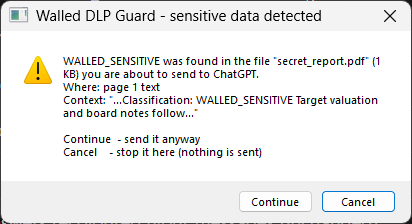

# Walled DLP Guard

**A standalone desktop DLP (data loss prevention) application for ChatGPT and Perplexity.** It inspects every
prompt and every uploaded file (text, PDF and image) for the marker **`WALLED_SENSITIVE`**. When the marker is
found, it shows a **native Windows Continue / Cancel dialog** *before* the data leaves the computer. It also changes
the text colour of AI-generated responses on both sites.

**Nothing is installed in the browser:** no extension, plugin or add-on. The app works at the network level, as a
local HTTPS proxy, the same way enterprise DLP agents do.



> **Demo video:** _link added after recording_ · Built for the Walled AI take-home assignment (screening round 2).

---

## Contents

1. [How it works](#how-it-works)
2. [Interception and enforcement](#interception-and-enforcement)
3. [Content inspection](#content-inspection-text-pdf-images)
4. [Response colour](#response-colour)
5. [Installation](#installation)
6. [Usage](#usage)
7. [Security and reliability](#security-and-reliability)
8. [Testing](#testing)
9. [Project layout](#project-layout)
10. [Limitations and trade-offs](#limitations-and-trade-offs)

---

## How it works

```
 Browser (Chrome / Edge, unchanged)
      │  Windows proxy auto-config (PAC) served by the app:
      │  only chatgpt.com, perplexity.ai and their upload storage → proxy; everything else → DIRECT
      ▼
 ┌───────────────────────── Walled DLP Guard (Python desktop app) ─────────────────────────┐
 │ local proxy 127.0.0.1:8899 (mitmproxy engine)                                             │
 │   TLS decrypted only for the AI sites (local CA the user trusts during setup)            │
 │   ┌───────────────┐   ┌────────────────────────┐   ┌──────────────────────────────────┐   │
 │   │ dlp_proxy.py  │──►│ scanner.py             │──►│ dialog.py                        │   │
 │   │ hold request, │   │ text · PDF (pypdf)     │   │ native Windows MessageBox        │   │
 │   │ classify      │   │ OCR (Tesseract)        │   │ Continue / Cancel                │   │
 │   └───────┬───────┘   └────────────────────────┘   └──────────────────────────────────┘   │
 │           │ Continue → forward original bytes · Cancel → 403, nothing sent                 │
 │           │ HTML responses → <style> that recolours AI answers                             │
 │ tray icon · PAC server · proxy settings saved and restored                                 │
 └───────────┼──────────────────────────────────────────────────────────────────────────────┘
             ▼
     chatgpt.com · perplexity.ai · their file storage
```

**Why a proxy:** a desktop app can't see what is typed inside a web page, but everything the page *sends* goes
over the network. Inspecting it at the proxy works in any browser, with no browser add-on, and before the data
reaches the AI service.

---

## Interception and enforcement

Every request to ChatGPT/Perplexity is **held** by the proxy while it is inspected (`agent/dlp_proxy.py`):

| Request | What happens |
|---|---|
| Prompt submission (ChatGPT `…/conversation`, Perplexity `…/perplexity_ask`) **without** the marker | Forwarded immediately, with no dialog |
| Prompt submission **with** the marker | Native dialog. **Continue** forwards the *original, unmodified* request. **Cancel** answers it locally with `403`, so nothing reaches the site. ChatGPT keeps the text in the input box, so the user can edit and retry. |
| File upload (multipart parts, or a raw `PUT`/`POST` to the storage host) | The file is scanned. If the marker is found, a dialog appears; Cancel blocks the upload and the user can re-attach later |
| Side requests carrying the prompt (analytics, search suggestions, Perplexity's live typing suggestions over WebSocket) | Never get their own dialog. They **follow the user's decision** for that prompt, and are **dropped while no decision exists**, so the text cannot leak early |

Details that make this reliable:

- **One dialog per prompt or file.** Concurrent and repeated requests with the same content share one answer
  (keyed by the normalised prompt, or the file's SHA-256). After Cancel, the same prompt asks again if the user
  resubmits.
- **Uploads go to object storage, not the chat host.** The app learns the storage host and the original file name
  from the site's own "create upload" response, so the dialog shows the real file name.
- **Responses stream normally.** Streamed answers (SSE) are passed straight through; only HTML pages are buffered,
  for recolouring.
- **Narrow decryption.** Only ChatGPT, Perplexity and their upload hosts are decrypted. Other traffic routed by the
  PAC is tunnelled untouched, and everything else never touches the app.

---

## Content inspection: text, PDF, images

`agent/scanner.py` detects file type by **content** (magic bytes), not by name.

| Content | Method |
|---|---|
| Prompts and text files | Decoded and matched. JSON and form bodies are walked string by string |
| PDF | `pypdf` text layer per page. If there's no match, the embedded images are **OCR'd** (scanned PDFs) |
| Images (PNG, JPEG, GIF, BMP, TIFF, WebP) | **Tesseract OCR** in up to 3 passes: grayscale/upscaled, then thresholded, then inverted for dark-mode screenshots |
| Office (`.docx/.xlsx/.pptx`), as a bonus | The XML inside the zip is scanned |

Matching is tolerant: case-insensitive, ignoring spaces, underscores and line breaks, and common OCR confusions
(`0→O`, `1→I`, `5→S`). Files that can't be inspected (password-protected, too large, OCR missing) also get a dialog
instead of being silently allowed.

The dialog says clearly **whether a prompt or a file** triggered it, and shows **the prompt text or the file name**
(plus where the marker was found, e.g. "page 1 text" or "OCR").

---

## Response colour

The proxy adds a `<style>` to the HTML of chatgpt.com and perplexity.ai. It targets only the AI answer containers
(ChatGPT `[data-dil-response]` / `[data-message-author-role=assistant]`; Perplexity `[data-renderer=lm]`, excluding
the user's own question bubble). ChatGPT's streaming renderer colours text through CSS variables
(`--d-stream-ink`), which are overridden too. If a page's Content-Security-Policy forbade inline styles, the app
would add a nonce for its own style only. The colour is configurable: `--color "#22c55e"`.

---

## Installation

Requirements: **Windows 10/11**, **Python 3.10+** (tested with 3.14), Chrome or Edge, and **Tesseract OCR**.

```bash
git clone https://github.com/yesubabu7/walled-ai-dlp-guard.git
cd walled-ai-dlp-guard
winget install --id UB-Mannheim.TesseractOCR      # OCR engine for images and scanned PDFs (one time)
setup.bat                                          # venv + packages + trust the local certificate
```

`setup.bat` runs `python dlp_guard.py --setup`. This creates a local certificate authority in
`%LOCALAPPDATA%\WalledDLPGuard` and adds it to the **current user's** trusted roots with `certutil`. Windows shows a
confirmation dialog; click **Yes**. (The certificate is named *mitmproxy*, after the proxy engine.)

## Usage

```bash
run.bat               # or: .venv\Scripts\python.exe dlp_guard.py
```

- A blue padlock shield appears in the system tray. While the app runs, Windows proxy settings point the browser at
  it (through PAC).
- **Start the app before opening ChatGPT/Perplexity**, or reload those tabs, so the browser uses the proxy for them.
- **Quit** from the tray icon (or press Ctrl+C). Proxy settings are restored automatically. After a crash they are
  restored on the next start, or with `uninstall.bat`.
- Options: `--color`, `--port`, `--pac-port`, `--no-system-proxy` (point a browser at `127.0.0.1:8899` manually),
  `--no-tray`.

Try it with the files in `samples/`. Each sensitive file has a clean twin:
`secret_note.txt`, `secret_report.pdf`, `secret_scanned.pdf`, `secret_screenshot.png`, `secret_dark_mode.jpg`.

**To uninstall:** `uninstall.bat` restores proxy settings and removes the certificate.

---

## Security and reliability

- **Fails closed.** Errors during inspection, an unanswered dialog (it auto-cancels after 2 minutes; Cancel is the
  default button) or unscannable files all result in Cancel or a question, never a silent allow.
- **Local only.** Content is inspected on the machine; nothing is sent anywhere for scanning. The log stores
  **metadata only** (site, file name, size, decision), never prompt text or file contents.
- **Narrow scope.** The PAC routes only the AI sites and their storage to the app. TLS is decrypted only for those
  hosts. The CA's private key stays in the user's profile and is removed by `--uninstall`.
- **Safe on exit.** The previous proxy setting is backed up before changing it, restored on quit and `atexit`, and
  recovered on the next start after a crash.
- **Concurrency.** The proxy is asyncio-based. Held requests don't block other traffic, OCR runs in worker threads,
  and dialogs are shown one at a time.

---

## Testing

```bash
.venv\Scripts\python.exe -m pip install -r requirements-dev.txt
.venv\Scripts\python.exe -m pytest -v
```

| Suite | Covers |
|---|---|
| `test_proxy.py` | The real mitmproxy addon on real flow objects: clean prompt passes, Cancel → 403, Continue forwards unchanged, Perplexity, one dialog for concurrent duplicates, retry after Cancel asks again, side requests follow the decision, PDF/OCR/clean uploads, learned storage host + file name, other sites untouched, HTML recolouring, CSP nonce, streamed answers, WebSocket suggestions dropped |
| `test_policy.py` | Host and submit-path rules, PAC, JSON/form/multipart/raw body parsing, upload-target learning, CSS injection |
| `test_scanner.py` | Marker variants, text/PDF/scanned PDF/image OCR, dark mode, Office files, corrupt and unknown files |
| `test_dialog.py` | The real native dialog auto-cancels on timeout |

Tests answer the dialog with a fake, or with `WALLED_DLP_AUTO_DECISION=continue|cancel`, so they need no clicks.
The proxy was also verified live against chatgpt.com and perplexity.ai.

---

## Project layout

```
dlp_guard.py         Entry point: --setup / run / --uninstall, tray, PAC, system proxy
agent/
  dlp_proxy.py       mitmproxy addon: hold, classify, decide, block/forward, recolour, WebSocket filter
  policy.py          Pure rules: sites, submit paths, PAC, body parsing, upload learning, CSS
  scanner.py         Marker detection: text, PDF (+OCR), images (OCR), Office XML
  dialog.py          Native Windows Continue/Cancel (MessageBox; buttons renamed via CBT hook)
  system.py          Local CA (certutil), PAC server, Windows proxy settings backup/restore
  tray.py            Tray icon with counts and Quit
  logger.py          Metadata-only logging
setup.bat / run.bat / uninstall.bat
samples/             Sensitive files and clean twins     scripts/make_samples.py
tests/               pytest suites
```

---

## Limitations and trade-offs

- **Needs a trusted local certificate.** Inspecting HTTPS requires decrypting it, so the user must trust the app's
  CA once. Browsers that use their own certificate store (Firefox, by default) need it imported separately.
- **Windows-first.** The native dialog, certificate install and proxy settings use Windows APIs. The scanner and
  proxy core are cross-platform.
- **Site changes.** Submit paths and answer selectors are kept in one place per site (`agent/policy.py`). If
  ChatGPT/Perplexity change them, the side-request rule still drops marker traffic (fail closed), but the
  recolouring or the prompt classification would need an update.
- **Block response.** On Cancel the site receives a `403` it didn't expect, so it shows its own error message. On
  ChatGPT the text stays in the box; on Perplexity the user re-types or edits it.
- **Already-open connections.** A tab opened before the app started may keep a direct connection until reloaded.
- **Marker only.** Detection is the single marker requested. Next steps would be PII/secret detectors, central
  policy, and an audit log.
